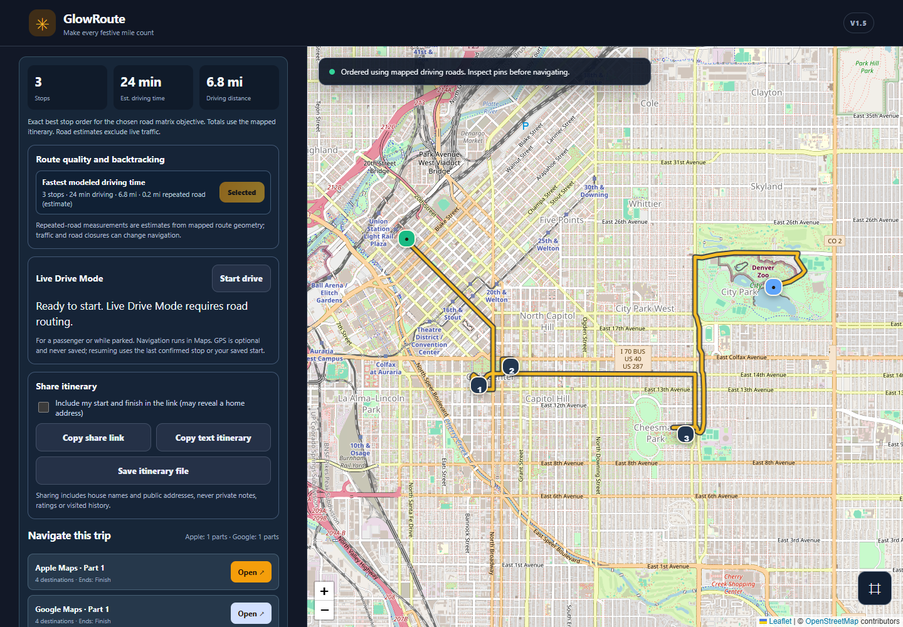
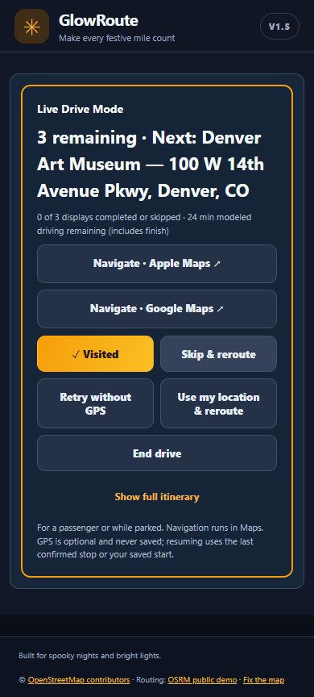

<p align="center"></p>

# 🎃🎄 GlowRoute

**Make every festive mile count.**

GlowRoute is a **free, open-source holiday display route planner** that helps you discover Halloween decorations and Christmas light displays, organize your favorites, and plan a more efficient driving tour—with less backtracking and more time to enjoy the displays.

Built for phones and desktops. No account required.



*Genuine browser capture with real OSM mapping and OSRM routing. Public Denver landmarks illustrate the workflow; they are not advertised holiday display listings.*

<p align="center"></p>

**[🚗 Open GlowRoute](https://jacobmgoodnight.github.io/glowroute/)** · [View source](https://github.com/jacobmgoodnight/glowroute) · [Report an issue or suggest a display](https://github.com/jacobmgoodnight/glowroute/issues)

> **Beta:** GlowRoute is an independently maintained route-planning tool, not a live directory of verified operating displays. Check listing dates, locations, hours and navigation before heading out.

**New in v1.5:** nationwide routing, dependable time/distance selection, cancellable and cached routing requests, a simpler first visit, focused mobile driving with resume, safer backups/sharing and reliable PWA updates. Read the [changelog](CHANGELOG.md), [audit and validation report](docs/AUDIT-v1.5.md), or [prioritized roadmap](ROADMAP.md).

**New in v1.6:** clearer seasonal/source context, directory sorting and filtered bulk selection, import diagnostics and stable review edits, plus personal preferences preserved in stop-list JSON round-trips. **v1.6.1 adds an adjustable desktop planner/map divider.** See the [v1.6 scope and validation](docs/RELEASE-v1.6.md). The screenshots above were captured during v1.5.

## ✨ What can GlowRoute do?

| Feature | What it helps you do |
| --- | --- |
| 🗺️ **Smarter routes** | Arrange selected houses using road-based travel times or distances, and compare route options for estimated repeated roadway. |
| 🎃🎄 **Halloween & Christmas drives** | Create separate trips by holiday and year, then duplicate a trip for next season. |
| 📍 **Find and import displays** | Explore an editor-maintained directory, add stops, paste address lists, or import CSV/TSV/TXT/JSON data. |
| ⏱️ **Plan around your time** | Set a total trip budget and estimated viewing time per house to select a worthwhile subset of stops. |
| ⭐ **Make it personal** | Favorite, rate, and mark must-see houses; keep private notes and track visited stops. |
| 🚗 **Live Drive Mode** | See the next stop, mark it visited, skip and reroute, or optionally reroute using your current location. |
| 📲 **Navigate in Maps** | Open your planned itinerary in Apple Maps or Google Maps in manageable legs. |
| 🔗 **Share and save** | Share a reviewed itinerary, save text directions, and back up or restore projects between devices. |

GlowRoute works for **your own neighborhood or any area where you have display addresses**. The built-in sample data focuses on Indianapolis-area holiday displays; it does not offer comprehensive nationwide discovery.

## 🚀 Start planning in a few steps

1. **Open [GlowRoute](https://jacobmgoodnight.github.io/glowroute/)** on your phone or computer.
2. **Choose _Explore a sample drive_ or _Plan my own drive_.** Existing users go straight to their saved projects. New custom drives start with blank endpoints; add full addresses from any city or browse the **Display directory**.
3. **Set Start and Finish.** Optionally use **Use my location** for this tab only; your entered starting address is retained. Choose displays, mark important stops **Must see**, and open the optional time budget if needed.
4. Select **Optimize my route**. Check the route, map pins and suggested order before you go.
5. Open a navigation leg in **Apple Maps or Google Maps**, or start **Live Drive Mode** for a focused next-stop view. A passenger or parked driver can mark visits, skip/reroute, retry without GPS and return to the full itinerary. After a reload, **Resume interrupted drive** uses saved remaining stops and your last confirmed display or saved starting address.

**Tip:** You can review imported addresses and edit a map pin before routing. Some residential addresses are geocoded only approximately.

**Desktop layout:** Drag the divider between the planner and map to resize them; your browser remembers the width. Focus the divider and use Left/Right arrows (Shift for larger steps), Home/End for the limits, or Enter to reset. Double-click also resets; Escape cancels a drag. Phones keep the stacked layout.

### Bring a list of your own displays

Open **Bulk import / paste list** and paste addresses from a public holiday guide or your notes. You can also use a CSV/TSV/TXT file or a GlowRoute JSON export. Review names, addresses and duplicates before adding them; addresses aren't checked as operating displays automatically.

For abbreviated street-only lists, enter the optional city/state. Complete addresses keep their supplied locality. Review ignored-record explanations, use **Select all eligible** or **Deselect all**, and switch between Add/Replace without losing edited rows. Append mode skips existing addresses and preserves their private data. Large lists can be reduced to a subset within the 70-display project limit; preview up to 500 unique addresses at once.

GlowRoute JSON stop exports preserve ratings, favorites, must-see flags, private notes, saved selection, visit state, source details and approved manual pins through import review. Same-holiday/year exports retain seasonal verification; importing into another holiday/year resets verification and visit/skip state. Old exports remain supported but need a seasonal recheck when they lack holiday/year context. These files can contain private data. Use **Backup all years** to restore complete projects, endpoints and settings.

**Import from a website** supports selected attributed source snapshots and direct browser-readable pages. It cannot automatically extract arbitrary websites, bypass their access restrictions, or live-sync third-party directories.

## 📚 About the display directory

The initial app includes **25 Irvington, Indianapolis-area Halloween addresses** and a curated featured selection. The separate, editor-maintained directory contains **31 historical or season-labeled address references** from attributed sources (including 2026 Halloween and 2025 Christmas references).

- **A listed address isn't a promise that the display is operating.** Check the listed season and original source before visiting.
- Directory updates are reviewed rather than automatically scraped or synced.
- **Source reviewed** dates describe editorial source review, not a visit or proof that the display operates. Past years are labeled **Archive**; current-year listings still require an operating check. Source notes and any sourced dates/hours are available under **Source notes & details**.
- Search and sort listings by city/area, season, name or source review date. **Select shown** affects the current filters; selections outside those filters remain counted until you clear them.
- You can suggest a publicly advertised display or correction using a **public GitHub issue**. Only share residential addresses that are already public or that you have permission to publish.
- For a removal request, use the catalog ID shown under a listing's source details. The app omits address/source URL fields from removal drafts; do not add private details in the notes.
- Duplicating a project into the next year marks its listings for seasonal verification.

The public directory lives in [`directory/catalog.json`](directory/catalog.json). FrightMaps and other external holiday directories may be linked for discovery but are **not** integrated as automatic data feeds.

## 🔒 Privacy and storage

GlowRoute runs as a static web app—**no accounts, hosted personal profiles or built-in analytics tracker**.

- Your projects, selected stops, ratings, notes and visited history live **in your browser's local storage**, not in a personal cloud account.
- **Back up all years** to a local JSON file and **Restore backup** to move your projects between browsers or devices. Projects don't automatically sync.
- Shared itinerary links, copied text and itinerary files include stop names and addresses. **Start and Finish are omitted by default in all three**; add them only if you're comfortable sharing those locations. Stop/project backup exports can include private data—keep those files private.
- Starting-point GPS and Live Drive rerouting request permission only after your action. Temporary GPS positions aren't saved in projects. Resume stores stop IDs and the last confirmed display, not a location trail.
- Map, address lookup and road-routing requests go to third-party mapping services. Entered addresses or coordinates are transmitted to those services as needed.
- A proposed display submitted as a GitHub issue is **public**, so do not include private contact details or unapproved home addresses.

## 📱 Add GlowRoute to your home screen

**iPhone:** Open the site in Safari, tap **Share**, and choose **Add to Home Screen**.

**Android:** Open the site in Chrome and use the browser menu's **Install app** or **Add to Home screen** option when available.

GlowRoute is a progressive web app (PWA). The interface may be cached, but **maps, geocoding, route optimization and navigation still require internet access**. It is not an offline navigation app.

After an application update, use **Save & reload** when prompted. The release shell updates without clearing projects, favorites or geocodes. If storage fails, export a backup before reloading. An offline directory copy is labeled as cached; historical listings are never real-time operating information.

## 🛠️ Running the project locally

GlowRoute is built with vanilla **HTML, CSS and JavaScript**, Leaflet and OpenStreetMap mapping, and browser local storage. It is designed to run directly on **GitHub Pages**, without a hosted database.

Serve the repository over HTTP (rather than double-clicking `index.html`; the app uses JavaScript modules):

```sh
python3 -m http.server 8080
```

Open [http://localhost:8080](http://localhost:8080). No build or package installation is required to run the app. For the automated tests, use Node.js 22+:

```sh
npm ci
npm test
npx playwright install chromium
npm run test:browser
```

Browser tests load the actual app modules with deterministic external-service fixtures at desktop/mobile viewports, including service-worker updates and offline fallback. They cannot verify live third-party uptime. GitHub Actions runs both suites on pull requests and pushes to `main`/release branches. See [CONTRIBUTING.md](CONTRIBUTING.md) for browser setup, legacy Python entry points and the optional genuine-screenshot/live-smoke script.

### Deploy with GitHub Pages

In **Settings → Pages**, select **Deploy from a branch**, choose `main` and `/ (root)`, then save. Keep `index.html` and `.nojekyll` at the repository root. For a fork, adjust any example URLs to your GitHub username and repository name.

## ⚙️ How routes work and important limits

<details>
<summary><strong>Routing, map services and accuracy details</strong></summary>

GlowRoute uses Leaflet with OpenStreetMap tiles, the US Census Geocoder and OpenStreetMap Nominatim for location lookup, and the public OSRM demo service for road-based routing.

- **Up to 12 display stops:** an exact dynamic-programming stop-order solver for the supplied time/distance matrix.
- **13–68 stops:** an improvement-based heuristic; it isn't guaranteed to find the global optimum.
- Road-based travel times and distances are modeled, **not live-traffic aware**. Route durations don't include parking, viewing time unless specified in the budget, closures or weather.
- The app can compare time-oriented and distance-oriented orders and estimate repeated roadway from mapped line segments. That estimate isn't a guarantee of minimum backtracking.
- Comparisons preserve your selected optimization objective. Mapped-itinerary totals are used consistently when available; summed matrix legs can differ. “Shortest modeled distance” optimizes the length of OSRM's fastest-road legs, not every possible road path.
- A time-budget tour uses a heuristic and personal ratings to select stops; marked **Must see** stops are mandatory, or the app reports that the budget is too small.
- Budget planning selects/orders by driving time; optional distance comparisons must fit the same modeled budget. Manual changes or full-route totals can exceed that estimate, in which case the summary warns you.
- Geocoding sometimes interpolates house positions. Review `≈` pins and use **Pin** to fix a placement before navigating.
- If the road-routing matrix is unavailable, optional **rough straight-line ordering** is explicitly approximate and can't support accurate driving-time budgeting.
- Apple Maps and Google Maps links are split into compatible navigation legs. Check each leg before driving; the navigation app may choose different roads.
- The public OSRM server is a **demo**, not production-grade infrastructure; public tile and geocoding services also have usage limits. Large-scale use needs suitable hosted services and rate limiting. Do not publish private production API keys inside this static app.
- OSRM requests are serialized at least 1.1 seconds apart per tab, time out after 12 seconds, and reuse a bounded five-minute memory cache. Cancellation prevents old requests from changing a later trip. There is no application-wide rate limiter across users/tabs.
- Respect the [OSRM service policy](https://routing.openstreetmap.de/about.html) and [Nominatim usage policy](https://operations.osmfoundation.org/policies/nominatim/), including its application-wide one-request-per-second maximum and restrictions on bulk queries. Public services are suitable only for small, policy-compliant use; this static app cannot guarantee aggregate quotas or uptime. The [audit](docs/AUDIT-v1.5.md#service-research-and-limits) records the provider research and growth limitations.

Please drive safely, use Live Drive Mode only while parked, and be considerate of residential neighborhoods.

</details>

## 🤝 Contributing and future ideas

Bug reports, usability feedback, verified public display suggestions and contributions are welcome via [GitHub Issues](https://github.com/jacobmgoodnight/glowroute/issues).

Start with [CONTRIBUTING.md](CONTRIBUTING.md) and the [roadmap](ROADMAP.md). The next priorities are clearer sourced seasonal details, directory/import review tools, permitted regional catalogs and physical-device accessibility/navigation checks. No new data partnerships or live verification feeds are implied.

Please respect directory source attribution, publishers' terms and residents' privacy when contributing listings.

## 📄 License

GlowRoute is released under the [MIT License](LICENSE).

---

*Built to make Halloween and Christmas light drives easier, one stop at a time.* ✨
