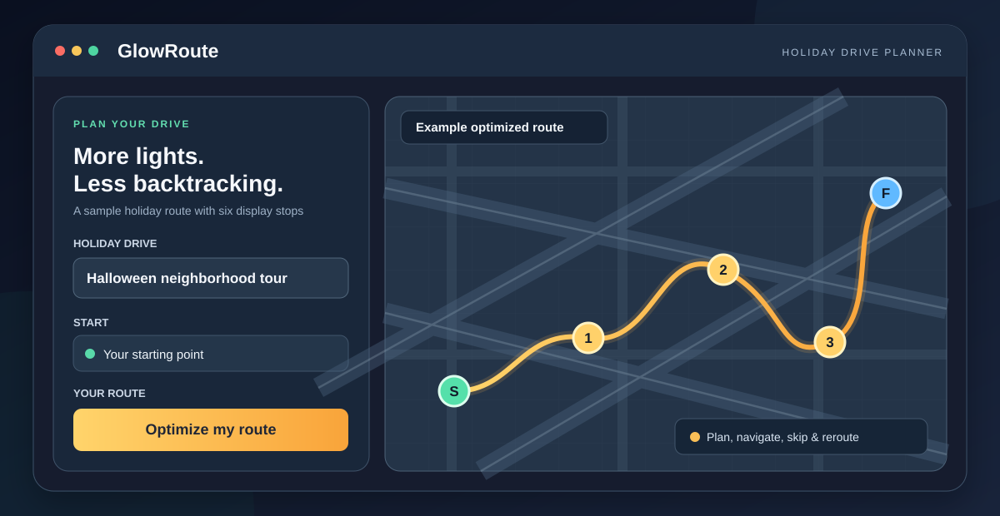

<p align="center"></p>

# 🎃🎄 GlowRoute

**Make every festive mile count.**

GlowRoute is a **free, open-source holiday display route planner** that helps you discover Halloween decorations and Christmas light displays, organize your favorites, and plan a more efficient driving tour—with less backtracking and more time to enjoy the displays.

Built for phones and desktops. No account required.



*Illustrated feature overview — not a screenshot of the live application.*

**[🚗 Open GlowRoute](https://jacobmgoodnight.github.io/glowroute/)** · [View source](https://github.com/jacobmgoodnight/glowroute) · [Report an issue or suggest a display](https://github.com/jacobmgoodnight/glowroute/issues)

> **Beta:** GlowRoute is an independently maintained route-planning tool, not a live directory of verified operating displays. Check listing dates, locations, hours and navigation before heading out.

## ✨ What can GlowRoute do?

| Feature | What it helps you do |
| --- | --- |
| 🗺️ **Smarter routes** | Arrange selected houses using road-based travel times or distances, and compare route options for estimated repeated roadway. |
| 🎃🎄 **Halloween & Christmas drives** | Create separate trips by holiday and year, then duplicate a trip for next season. |
| 📍 **Find and import displays** | Explore an editor-maintained directory, add stops, paste address lists, or import CSV/TSV/TXT/JSON data. |
| ⏱️ **Plan around your time** | Set a total trip budget and estimated viewing time per house to select a worthwhile subset of stops. |
| ⭐ **Make it personal** | Favorite, rate, and mark must-see houses; keep private notes and track visited stops. |
| 🚗 **Live Drive Mode** | See the next stop, mark it visited, skip and reroute, or optionally reroute using your current location. |
| 📲 **Navigate in Maps** | Open your planned itinerary in Apple Maps or Google Maps in manageable legs. |
| 🔗 **Share and save** | Share a reviewed itinerary, save text directions, and back up or restore projects between devices. |

GlowRoute works for **your own neighborhood or any area where you have display addresses**. The built-in sample data focuses on Indianapolis-area holiday displays; it does not offer comprehensive nationwide discovery.

## 🚀 Start planning in a few steps

1. **Open [GlowRoute](https://jacobmgoodnight.github.io/glowroute/)** on your phone or computer.
2. **Choose a saved drive or select _+ New drive_.** Start with the built-in Irvington Halloween example, browse the **Display directory**, or add your own locations.
3. **Set Start and Finish.** Choose the displays you want to visit. Optionally set a time budget and mark important stops **Must see**.
4. Select **Optimize my route**. Check the route, map pins and suggested order before you go.
5. Open a navigation leg in **Apple Maps or Google Maps**. Use **Live Drive Mode** while parked to track visited stops or reroute around a skip.

**Tip:** You can review imported addresses and edit a map pin before routing. Some residential addresses are geocoded only approximately.

### Bring a list of your own displays

Open **Bulk import / paste list** and paste addresses from a public holiday guide or your notes. You can also use a CSV/TSV/TXT file or a GlowRoute JSON export. Review names, addresses and duplicates before adding them; addresses aren't checked as operating displays automatically.

**Import from a website** supports selected attributed source snapshots and direct browser-readable pages. It cannot automatically extract arbitrary websites, bypass their access restrictions, or live-sync third-party directories.

## 📚 About the display directory

The initial app includes **25 Irvington, Indianapolis-area Halloween addresses** and a curated featured selection. The separate, editor-maintained directory contains **31 historical or season-labeled address references** from attributed sources (including 2026 Halloween and 2025 Christmas references).

- **A listed address isn't a promise that the display is operating.** Check the listed season and original source before visiting.
- Directory updates are reviewed rather than automatically scraped or synced.
- You can suggest a publicly advertised display or correction using a **public GitHub issue**. Only share residential addresses that are already public or that you have permission to publish.
- Duplicating a project into the next year marks its listings for seasonal verification.

The public directory lives in [`directory/catalog.json`](directory/catalog.json). FrightMaps and other external holiday directories may be linked for discovery but are **not** integrated as automatic data feeds.

## 🔒 Privacy and storage

GlowRoute runs as a static web app—**no accounts, hosted personal profiles or built-in analytics tracker**.

- Your projects, selected stops, ratings, notes and visited history live **in your browser's local storage**, not in a personal cloud account.
- **Back up all years** to a local JSON file and **Restore backup** to move your projects between browsers or devices. Projects don't automatically sync.
- Shared itinerary links include stop names and addresses. **Start and Finish are omitted by default**; add them only if you're comfortable sharing those locations.
- Live Drive Mode may request location permission to reroute. The temporary GPS position isn't saved in your projects.
- Map, address lookup and road-routing requests go to third-party mapping services. Entered addresses or coordinates are transmitted to those services as needed.
- A proposed display submitted as a GitHub issue is **public**, so do not include private contact details or unapproved home addresses.

## 📱 Add GlowRoute to your home screen

**iPhone:** Open the site in Safari, tap **Share**, and choose **Add to Home Screen**.

**Android:** Open the site in Chrome and use the browser menu's **Install app** or **Add to Home screen** option when available.

GlowRoute is a progressive web app (PWA). The interface may be cached, but **maps, geocoding, route optimization and navigation still require internet access**. It is not an offline navigation app.

## 🛠️ Running the project locally

GlowRoute is built with vanilla **HTML, CSS and JavaScript**, Leaflet and OpenStreetMap mapping, and browser local storage. It is designed to run directly on **GitHub Pages**, without a hosted database.

Serve the repository over HTTP (rather than double-clicking `index.html`; the app uses JavaScript modules):

```sh
python3 -m http.server 8080
```

Open [http://localhost:8080](http://localhost:8080). For the automated tests, use Node.js 18+ and Python:

```sh
node --test tests/*.test.mjs
python tests/projects_browser.py
python tests/directory_browser.py
python tests/tour_browser.py
```

Browser tests use local stand-ins for external routing and map services; they cannot verify live third-party uptime.

### Deploy with GitHub Pages

In **Settings → Pages**, select **Deploy from a branch**, choose `main` and `/ (root)`, then save. Keep `index.html` and `.nojekyll` at the repository root. For a fork, adjust any example URLs to your GitHub username and repository name.

## ⚙️ How routes work and important limits

<details>
<summary><strong>Routing, map services and accuracy details</strong></summary>

GlowRoute uses Leaflet with OpenStreetMap tiles, the US Census Geocoder and OpenStreetMap Nominatim for location lookup, and the public OSRM demo service for road-based routing.

- **Up to 12 display stops:** an exact dynamic-programming stop-order solver for the supplied time/distance matrix.
- **13–68 stops:** an improvement-based heuristic; it isn't guaranteed to find the global optimum.
- Road-based travel times and distances are modeled, **not live-traffic aware**. Route durations don't include parking, viewing time unless specified in the budget, closures or weather.
- The app can compare time-oriented and distance-oriented orders and estimate repeated roadway from mapped line segments. That estimate isn't a guarantee of minimum backtracking.
- A time-budget tour uses a heuristic and personal ratings to select stops; marked **Must see** stops are mandatory, or the app reports that the budget is too small.
- Geocoding sometimes interpolates house positions. Review `≈` pins and use **Pin** to fix a placement before navigating.
- If the road-routing matrix is unavailable, optional **rough straight-line ordering** is explicitly approximate and can't support accurate driving-time budgeting.
- Apple Maps and Google Maps links are split into compatible navigation legs. Check each leg before driving; the navigation app may choose different roads.
- The public OSRM server is a **demo**, not production-grade infrastructure; public tile and geocoding services also have usage limits. Large-scale use needs suitable hosted services and rate limiting. Do not publish private production API keys inside this static app.

Please drive safely, use Live Drive Mode only while parked, and be considerate of residential neighborhoods.

</details>

## 🤝 Contributing and future ideas

Bug reports, usability feedback, verified public display suggestions and contributions are welcome via [GitHub Issues](https://github.com/jacobmgoodnight/glowroute/issues).

Potential future work includes higher-quality verified listing feeds (with permission), improvements to geocoding and routing reliability, better road-overlap optimization, and optional community-supplied display details. None of these are presented as current live features.

Please respect directory source attribution, publishers' terms and residents' privacy when contributing listings.

## 📄 License

GlowRoute is released under the [MIT License](LICENSE).

---

*Built to make Halloween and Christmas light drives easier, one stop at a time.* ✨
